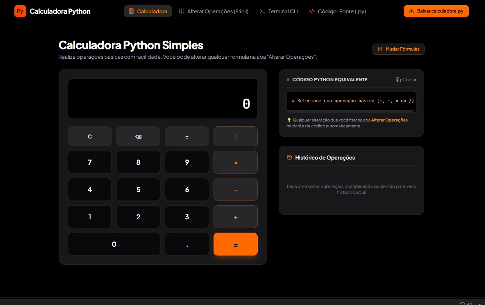

# 🧮 Calculadora Simples (Python & Web)

Projeto desenvolvido para fixar os conceitos fundamentais de lógica de programação, unindo um script de calculadora em **Python** com uma interface interativa moderna.

---

## 📸 Demonstração Visual


---

## 🚀 Tecnologias Utilizadas

* **Python:** Script lógico para execução de operações básicas no terminal.
* **HTML5 / CSS3 / JavaScript:** Estrutura, design responsivo e lógica interativa da interface web.

---

## 📁 Estrutura do Repositório

```text
📦 Calculadora-simples
 ┣ 📂 Web
 ┃ ┣ 📜 index.html
 ┃ ┣ 📜 script.js
 ┃ ┗ 📜 style.css
 ┣ 📜 calculadora.py
 ┗ 📜 preview.png


Como Executar o Projeto
1. Versão Python (Terminal CLI)
Certifique-se de ter o Python instalado na sua máquina e execute o seguinte comando no terminal na raiz do projeto:

Bash
python calculadora.py

2. Versão Web
Basta abrir o arquivo index.html (localizado dentro da pasta Web) diretamente em qualquer navegador de internet para interagir com a interface gráfica da calculadora.